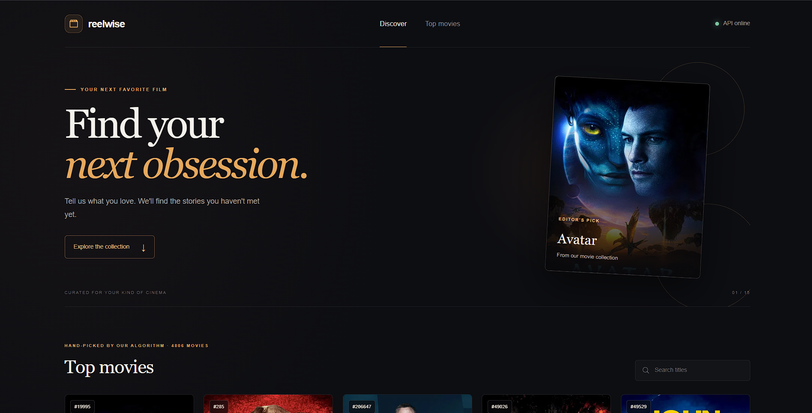
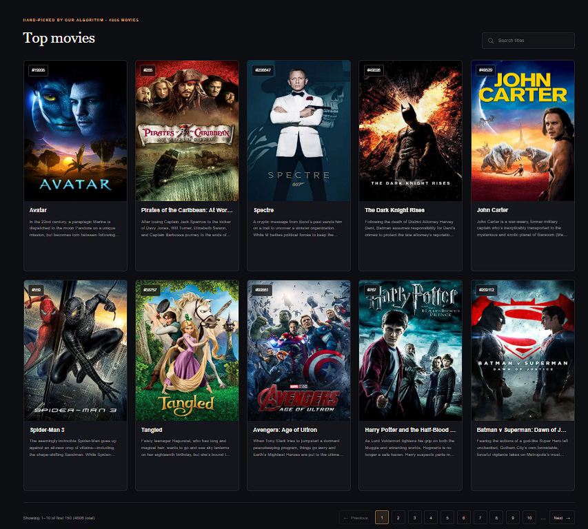
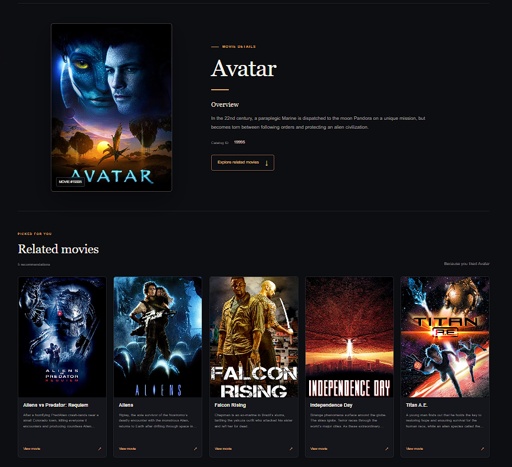

# Movie Recommendation System

A full-stack movie recommendation application built with a FastAPI backend and a Next.js frontend. The app loads a precomputed movie catalog and recommendation model from pickled files, fetches movie metadata from TMDB, and lets users browse and view personalized movie suggestions.

## Screenshots

### Discover movies



### Browse top movies



### Movie details and recommendations



## Features

- Browse a paginated movie catalog
- Search movies by title on the current page
- View movie details and recommendations for a selected movie
- Use a FastAPI backend for movie listing and prediction endpoints
- Proxy backend requests through Next.js API routes to avoid frontend CORS issues
- Fetch poster and overview data from TMDB

## Tech Stack

- Backend: Python, FastAPI, Pandas
- Frontend: Next.js, React, TypeScript
- Data source: TMDB API
- Model assets: pickle files in `backend/app/model/`

## Project Structure

```text
movie_recommendation_system/
├── backend/
│   ├── app/
│   ├── main.py
│   ├── pyproject.toml
│   └── README.md
├── frontend/
│   ├── app/
│   ├── package.json
│   └── README.md
├── README.md
└── README.MD
```

## Backend API

The backend is served from the `backend/` folder and exposes the following endpoints:

- `GET /` — welcome message
- `GET /health` — health check
- `GET /movie/top?page=1&limit=10` — list movies with pagination
- `POST /movie/predict/{id}` — get recommendation IDs for a given movie

FastAPI auto-generated docs are available at:

- `http://localhost:8000/docs`
- `http://localhost:8000/redoc`

## Frontend

The frontend is a Next.js app that calls API routes such as:

- `/api/health`
- `/api/movies?page=1&limit=10`
- `/api/movies/[id]/recommendations`

These route handlers proxy requests to the Python backend, which keeps the browser and backend communication consistent.

## Environment Setup

### Backend

Create a `.env` file inside the `backend/` directory with your TMDB configuration:

```env
TMDB_API_KEY=your_tmdb_api_key
TMDB_BASE_URL=https://api.themoviedb.org/3/movie
TMDB_IMAGE_BASE_URL=https://image.tmdb.org/t/p/w500
```

### Frontend

If the frontend should connect to a backend running on a different host or port, add a `.env.local` file in `frontend/`:

```env
MOVIE_API_URL=http://localhost:8000
```

## Run the Project

### 1) Start the backend

```bash
cd backend
python -m venv .venv
# Activate the virtual environment
# Windows: .venv\Scripts\activate
# macOS/Linux: source .venv/bin/activate
pip install -r requirements.txt
# or if using uv:
# uv sync
python main.py
```

The API will be available at `http://localhost:8000`.

### 2) Start the frontend

```bash
cd frontend
npm install
npm run dev
```

Open `http://localhost:3000` in the browser to use the app.

## Notes

- The backend uses pre-generated pickle files in `backend/app/model/` for the movie catalog and recommendation index.
- If TMDB API credentials are missing or requests fail, the app falls back to placeholder poster and title data.
- The UI limits browsing to the first 150 movies for smoother client-side experience.

## License

This project is for educational and demonstration purposes.
